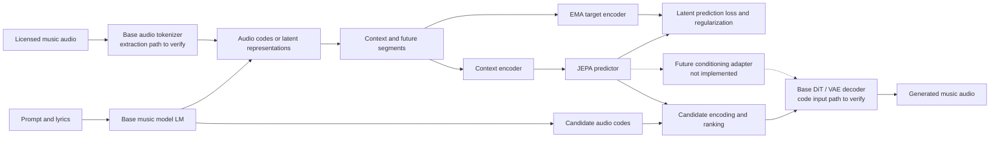

# Auralis: A JEPA-Based World Model for Music

**Research proposal · Version 0.2 · Untrained and unvalidated**  
**Author: Weifeng Zhao (赵伟峰)**

## Abstract

Auralis explores predictive representations over discrete audio codes or continuous latent representations inside audio music generation systems. Its primary modeling input is derived from music audio rather than MIDI scores. The central hypothesis is that predicting representations of future music segments may capture relationships useful for music generation. Candidate ranking is proposed as an initial application; generator conditioning is a later research direction. The model has not been trained, has no weights or evaluation results, and has not been integrated with ACE-Step. The claims in this report are hypotheses, not demonstrated results.

## 1. Positioning and prior work

Symbolic music such as MIDI and scores, discrete neural audio tokens, continuous audio latents, and natural-language descriptions are distinct objects. This proposal focuses initially on discrete representations produced or used by an audio generation model. Such codes can entangle melody, rhythm, timbre and other features; a token is not assumed to correspond to an interpretable note, chord, or semantic unit.

ACE-Step 1.5 combines a language model and diffusion transformer [1]. Its official API documentation describes approximately 5 Hz audio codes and task-dependent behavior [2]. The term “semantic token” does not by itself establish disentangled musical semantics. Extracting codes from audio, producing candidates with a shared context, and rendering specified codes must all be tested against a pinned code and weight version. Hierarchical musical sketches and audio generation have prior art, including SongBloom [3]; hierarchy and audio tokens alone are not a novelty claim. Music-JEPA [4] instead studies action-conditioned piano sound dynamics, while AudioLM [5] illustrates audio token representations and their trade-offs.

## 2. Architecture



This is a proposed data flow, not an implemented end-to-end system. Base-model interfaces and the representation-to-audio path remain unverified. The code in this package implements only a generic, token-window JEPA training prototype; it does not implement the audio tokenizer, base model, ranking or decoding.

## 3. Research hypotheses

- H1: Predicting future representations can yield features useful for cross-segment musical relationships.
- H2: With the same candidate set, generation conditions and compute budget, JEPA-based ranking can improve independent measures of continuity or control.
- H3: With genuinely executable generation controls, a later action-conditioned model might support multi-step planning; this requires real interventions and closed-loop evaluation.

Prediction does not establish musical understanding. Representations may capture track identity, timbre, loudness or position shortcuts. A small latent error does not imply good music, and a deterministic prediction may average several valid futures.

## 4. Training design

Obtain a token sequence c from licensed music audio using a frozen, verified tokenizer. Partition each sequence into context c_ctx and future c_tgt. The online encoder fθ processes only context, the target encoder fξ processes the future, and the predictor gφ predicts a target representation:

```text
z_ctx = fθ(c_ctx)
z_tgt = stop_gradient(fξ(c_tgt))
z_pred = gφ(z_ctx)
L = MSE(z_pred, z_tgt) + λ × variance_regularization
```

The target weights are updated by EMA. Monitor per-dimension variance, covariance, effective rank and constant-output baselines; neither EMA nor variance regularization guarantees avoidance of collapse. The future must not leak into the context input. An initial experiment could use 8 seconds of context and 4 seconds of target, but these are experimental windows, not necessarily musical phrases. Compare fixed-time and beat-aligned windows where reliable beat data exists. Multi-hypothesis or distributional prediction may be needed for genuinely ambiguous futures.

The supplied generic code uses 40 context and 20 future tokens by default. These correspond to 8 and 4 seconds only for a 5 Hz tokenizer; the code accepts integer arrays and does not infer a token rate or extract real audio codes.

## 5. Integration and experiments

1. **Feasibility:** pin an ACE-Step version and verify audio-to-code extraction, generation of multiple valid continuations sharing a context, and rendering selected codes. Check model and dataset licenses. If supported interfaces are unavailable, adapt the experiment instead of claiming the integration works.
2. **Representation learning:** cache token sequences, train JEPA, and inspect collapse and track/position/timbre shortcuts.
3. **Candidate ranking:** generate a common set of K candidates; compare JEPA scores with independent objectives and render only when the base model supports the path.
4. **Condition injection:** if ranking is useful, train an adapter into a supported conditioning path. Arbitrary JEPA vectors cannot be assumed to work as direct API inputs.
5. **Action and planning:** define executable edit controls and paired outcomes; train an action-conditioned transition and evaluate predictions after actually executing selected actions.

Compare the base choice or random ranking, simple statistics/retrieval, and a similarly sized non-JEPA representation under matched candidates and compute. Use independent structure, repetition/variation and prompt-adherence measures alongside blind listening. Split by composition and related recording versions, document random seeds and report variation and cost. Internal latent distance alone is not a quality metric. If no improvement appears on natural audio or independent evaluations, revise the hypothesis or stop scaling.

## 6. Candidate datasets

- [FMA](https://github.com/mdeff/fma): diverse music recordings; filter individual track licenses and verify intended use.
- [MAESTRO](https://magenta.withgoogle.com/datasets/maestro): aligned piano audio and MIDI; use audio as input and MIDI for optional evaluation. Piano repertoire is a narrow domain.
- [Slakh2100](https://www.slakh.com/): synthetic multitrack audio and aligned MIDI for controlled experiments; account for duplicate MIDI and synthetic-to-real differences.
- [MusicCaps](https://github.com/google-research/google-research/tree/master/music_caps): descriptive captions for possible evaluation; verify audio access and usage rights separately.

Check release terms and underlying work/recording rights independently. Track dataset versions, provenance, splits, audio preprocessing and tokenizer version. The code does not automatically deduplicate or split data.

## 7. Current status and limitations

This is an untrained research proposal with generic prototype training code. There is no integrated audio tokenizer, ACE-Step connector, validation pipeline, trained checkpoint, listening sample or measured gain. The earlier MIDI-editing prototype addressed a different problem and is not part of this release. The code has not yet been run in a PyTorch environment. Naming and intellectual-property checks are incomplete.

## References

1. [ACE-Step 1.5](https://arxiv.org/abs/2602.00744).
2. [ACE-Step 1.5 official API documentation](https://github.com/ace-step/ACE-Step-1.5/blob/main/docs/en/API.md).
3. [SongBloom: Coherent Song Generation via Interleaved Autoregressive Sketching and Diffusion Refinement](https://papers.nips.cc/paper_files/paper/2025/file/3107ddd4209e5f93c0371425763041a3-Paper-Conference.pdf).
4. [Music-JEPA: Learning a World Model of Sound from Action](https://arxiv.org/abs/2607.22000).
5. [AudioLM: a Language Modeling Approach to Audio Generation](https://arxiv.org/abs/2209.03143).
