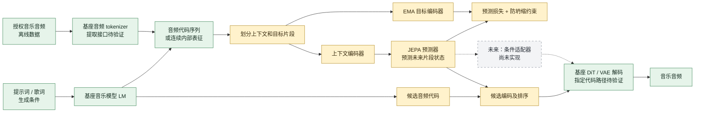

# Auralis：基于 JEPA 的音乐世界模型

**English:** Auralis: A JEPA-Based World Model for Music

**研究提案 · 版本 0.2 · 尚未训练、接入或验证**  
**作者：赵伟峰（Weifeng Zhao）**

## 摘要

Auralis 探索在音频音乐生成模型的离散音频代码或连续潜在表征之上，学习音乐片段之间的预测关系。其主要输入来自音频音乐模型，不把 MIDI 乐谱当作主要建模对象。核心假设：对较长时间尺度的内部表示进行潜在预测，可能提供有助于音乐生成的结构信息。第一阶段研究候选片段排序，第二阶段才考虑条件注入。本提案尚未训练、没有权重或评测，也未接入 ACE-Step。

## 一、研究定位

符号音乐（MIDI / 乐谱）、模型中的离散 token、连续音频潜变量和语言描述是不同对象。本研究优先探索音频生成模型的中间离散 token。离散 token 可能混合旋律、节奏、音色和其他信息，不假定 token 等同于音符、和弦或可解释语义。

候选基座 ACE-Step 1.5 结合语言模型与扩散模型 [1]，官方文档列出约 5Hz 的音频代码接口，并描述不同模式的处理差异 [2]。接口名称不能证明代码具有可分离的音乐语义，且如何从音频提取代码、控制候选生成和指定代码解码，需要固定版本、检查源码并实测。SongBloom 等工作已有分层音乐草图和音频生成 [3]；分层和音频 token 本身不能作为新颖贡献。

## 二、架构图



绿色表示拟复用的外部模型能力，黄色表示拟研发模块，灰色为后续设想。它们不是已运行的集成。具体提取、共享前文候选和代码解码能力均须验证；若不支持则研究源码或调整实验。

## 三、研究假设

- **H1**：跨时间片段的潜在预测可能学习到对结构关系有用的信息。
- **H2**：在同一组候选和相同计算预算下，JEPA 排序可能改善连贯性或特定控制目标。
- **H3**：引入可执行的生成控制后，潜在预测可能帮助多步规划；须真实执行动作并验证。

预测能力不自动等于音乐理解。token 可能保留曲目身份、音色或响度等捷径；预测误差低也不等于音乐好听。未来音乐有多种合理走向，单点预测可能退化为平均结果。

## 四、训练设计

对授权音乐音频提取基座内部序列 c，并选择上下文 c_ctx 与后续目标 c_tgt。冻结已验证的基座 tokenizer，训练在线编码器 fθ、目标编码器 fξ 和预测器 gφ：

```
z_ctx = fθ(c_ctx)
z_tgt = stop_gradient(fξ(c_tgt))
z_pred = gφ(z_ctx, 目标时长或位置)
损失 = MSE(z_pred, z_tgt) + λ × 表示方差约束
```

目标编码器通过 EMA 更新；检查每维方差、协方差和有效秩。EMA 和正则不能保证防止坍缩。训练时目标片段只进入目标分支，不能泄漏给上下文编码器。可先比较 8 秒上下文 / 4 秒目标与其他窗口；它们是实验参数，不等同于音乐乐句。未来可以比较多假设或条件分布预测，处理同一前文存在多种合理后续的问题。

初版是**无动作的未来状态预测**。只有以后定义基座实际支持、能执行和测量的编辑控制，并训练动作条件转移、进行闭环评估后，才可检验规划能力。

## 五、接入与实验阶段

1. **可行性检查**：固定 ACE-Step 版本；验证从音频提取代码、基于同一上下文产生候选、使用指定代码生成音频。确认权重、依赖和数据许可。
2. **表征训练**：用授权音频缓存真实音频 token，训练 JEPA，并评估坍缩、位置和曲目身份捷径。
3. **候选排序**：同一基座生成 K 个候选，JEPA 对候选表示评分，实际解码试听；如接口不支持，先实现并验证相应适配器。
4. **条件注入**：仅在排序实验有价值时，训练适配器连接支持条件控制的生成器；不能直接把任意 JEPA 向量送入 API。
5. **动作与规划**：定义真实可执行的编辑动作、采集动作及结果、预测多步效果并真实执行验证。

候选选择需与随机或基座默认选择、简单统计/检索规则、同规模的非 JEPA 表征比较；候选数量和预算一致。使用独立的段落和重复关系指标、提示词匹配及人工盲听；模型自身潜在距离不是音乐质量指标。

## 六、建议数据

- [FMA](https://github.com/mdeff/fma)：多风格音乐数据；逐项核对曲目许可与授权，过滤符合研究用途的数据。
- [MAESTRO](https://magenta.withgoogle.com/datasets/maestro)：配对钢琴演奏音频与 MIDI；音频作为主要输入，MIDI 可用于辅助分析。领域较窄。
- [Slakh2100](https://www.slakh.com/)：合成多轨音频及对齐 MIDI；可做控制变量实验，需处理重复 MIDI 和合成域差异。
- [MusicCaps](https://github.com/google-research/google-research/tree/master/music_caps)：音乐文字描述可用于评估；音频可获得性和使用条件应另行核验。

按作品及相关录音版本去重并划分训练、验证、测试；记录来源、许可、音频预处理与模型版本。数据集条款与底层音乐作品权利须分别核对。

## 七、现状与终止条件

目前提供基于预提取 token 的最小训练原型，但没有真实音频 token 提取器、基座连接器、权重、指标或试听。上一版 MIDI 编辑原型属于不同研究问题，已从当前项目包移除。如果 JEPA 在公平对照、自然音频和独立评估中不能提供增益，应停止扩大模型规模或调整假设。

## 参考资料

1. [ACE-Step 1.5 论文](https://arxiv.org/abs/2602.00744)。
2. [ACE-Step 1.5 官方 API 文档](https://github.com/ace-step/ACE-Step-1.5/blob/main/docs/en/API.md)。
3. [SongBloom](https://papers.nips.cc/paper_files/paper/2025/file/3107ddd4209e5f93c0371425763041a3-Paper-Conference.pdf)。
4. [Music-JEPA](https://arxiv.org/abs/2607.22000)。
5. [AudioLM](https://arxiv.org/abs/2209.03143)。
